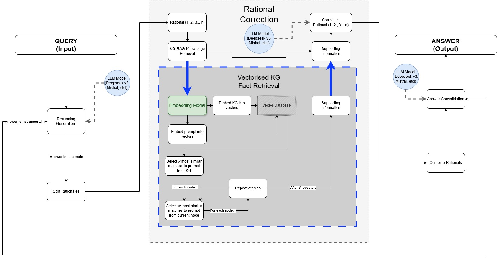
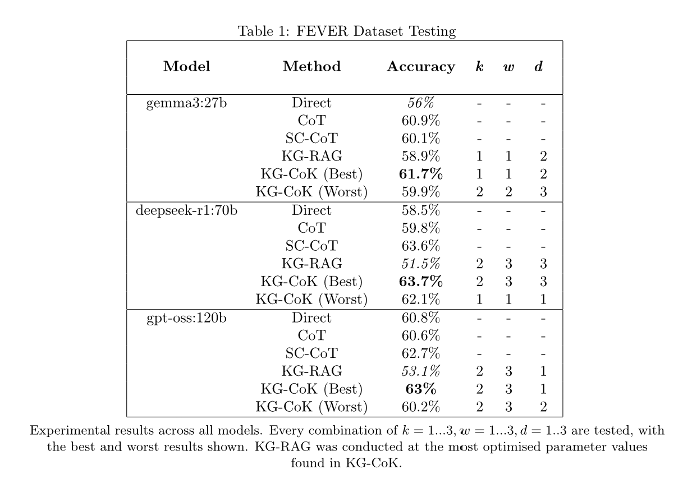
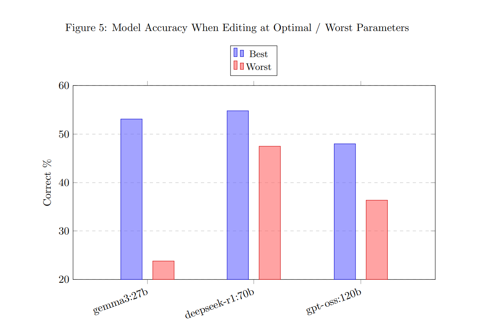
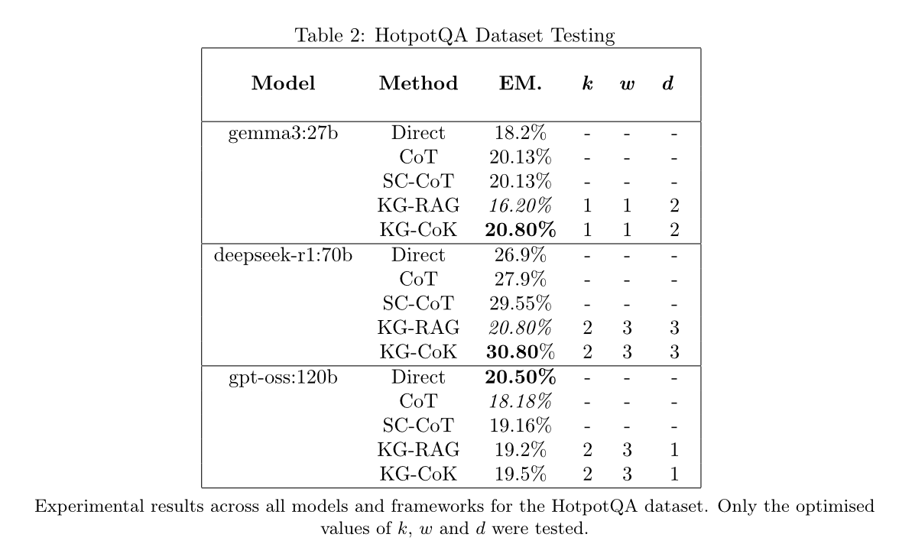
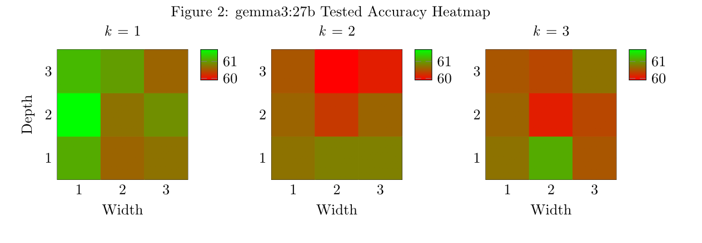
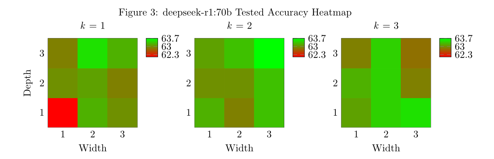
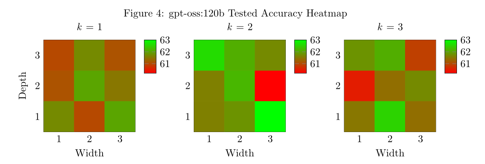

# KG-CoK
### Knowledge Graph Augmented Chain-of-Knowledge for Reliable AI Tutoring Systems

> Honours Thesis Project exploring the integration of Knowledge Graph Retrieval-Augmented Generation (KG-RAG) into the Chain-of-Knowledge framework to improve the accuracy and trustworthiness of LLM-based tutoring systems.

---

## Overview

Large Language Models are increasingly used for educational applications, but often suffer from hallucinations and unreliable reasoning.

KG-CoK introduces a novel framework that combines:

- Chain-of-Thought (CoT)
- Self-Consistent Chain-of-Thought (SC-CoT)
- Chain-of-Knowledge (CoK)
- Knowledge Graph Retrieval-Augmented Generation (KG-RAG)

The goal is to improve both factual accuracy and educational usefulness by combining structured knowledge retrieval with rationale correction.

---

## What I Built

During this honours project, I:

- Extended the original Chain-of-Knowledge framework
- Developed a KG-RAG-based retrieval kernel
- Integrated graph traversal over Wikidata embeddings
- Added automated rationale correction using retrieved knowledge
- Built an experimental evaluation pipeline
- Benchmarked multiple local LLMs using Ollama
- Conducted large-scale parameter sweeps across 81 configurations
- Evaluated results using the FEVER and HotpotQA benchmark datasets

---

# Architecture



The KG-CoK framework extends Chain-of-Knowledge by replacing traditional retrieval with Knowledge Graph RAG. When model responses are inconsistent, KG-RAG is used to retrieve structured knowledge and correct reasoning chains before answer regeneration.

---

# Experimental Setup

## Models Tested

- Gemma3 27B
- DeepSeek-R1 70B
- GPT-OSS 120B

## Datasets

- FEVER
- HotpotQA

## Technologies

- Python
- Ollama
- Wikidata Embedding Project (WEP)
- JSON
- Bash
- Linux

---

# Results

## FEVER Benchmark Results



### FEVER Performance Comparison


FEVER KG-CoK achieved the highest accuracy on every model tested.
- Improvements were strongest after parameter optimisation.
- Pure KG-RAG frequently underperformed KG-CoK and SC-CoT.

---

## HotpotQA Benchmark Results



### Key Takeaways

- KG-CoK achieved the highest Exact Match score on most tested models.
- DeepSeek-R1 showed the largest improvement.
- GPT-OSS displayed different behaviour, suggesting model-specific optimisation requirements.

---

# Parameter Optimisation

One of the primary findings of this research was that KG-RAG performance is highly sensitive to graph traversal parameters. These parameters were explored only during FEVER testing due to restrictions on available computing time.

Parameters explored:

| Parameter | Description |
|------------|------------|
| k | Initial starting nodes |
| w | Graph traversal width |
| d | Graph traversal depth |

A complete parameter sweep was conducted:

```text
3 values of k
× 3 values of w
× 3 values of d
= 27 configurations per model

27 configurations
× 3 LLMs
= 81 total benchmark runs
```

---

## Gemma3 27B Parameter Sweep



**Best Parameters**

```text
k = 1
w = 1
d = 2
Accuracy = 61.7%
```

This model benefited from relatively shallow graph exploration and demonstrated the strongest relative improvement from KG-CoK.

---

## DeepSeek-R1 70B Parameter Sweep



**Best Parameters**

```text
k = 2
w = 3
d = 3
Accuracy = 63.7%
```

DeepSeek benefited from considerably larger graph exploration than Gemma3, suggesting greater ability to utilise extended context.

---

## GPT-OSS 120B Parameter Sweep



**Best Parameters**

```text
k = 2
w = 3
d = 1
Accuracy = 63.0%
```

GPT-OSS showed highly variable behaviour and was the most sensitive model to parameter selection.

---

# Key Research Findings

## Smaller Models Benefit Most

The largest relative improvements were found on Gemma3 27B.

Despite being significantly smaller, KG-CoK allowed it to achieve performance that rivalled or exceeded larger baseline models.

## KG-RAG Alone Is Insufficient

Direct application of KG-RAG often reduced accuracy.

However, KG-RAG was highly effective when used during rationale correction inside the KG-CoK framework.

## Depth Matters

Graph depth (`d`) was consistently one of the most sensitive parameters.

Broader, shallower searches often outperformed deeper graph traversal.

## Parameter Tuning Is Essential

Performance varied substantially depending on the values chosen for:

- k
- w
- d

Incorrect parameter selections could reduce model accuracy below baseline performance.

---

# Future Work

Potential future enhancements include:

- Similarity-score filtering of graph nodes
- Adaptive parameter selection
- Domain-specific knowledge graphs
- Educational user studies
- Knowledge-graph security evaluation
- Real-world AI tutoring systems

---

# Thesis

This repository accompanies my honours thesis:

> **KG-CoK: Advancing Accuracy and Trust in Knowledge Graph-Augmented LLM-Based Tutoring Systems**

The project investigates how graph-based retrieval can improve reasoning reliability, factual accuracy, and educational usefulness in modern LLM systems.

---

# Citation

```bibtex
@thesis{childs2025kgcok,
  title={KG-CoK: Advancing Accuracy and Trust in Knowledge Graph-Augmented LLM-Based Tutoring Systems},
  author={Childs, Thomas Marshall},
  year={2025}
}
```